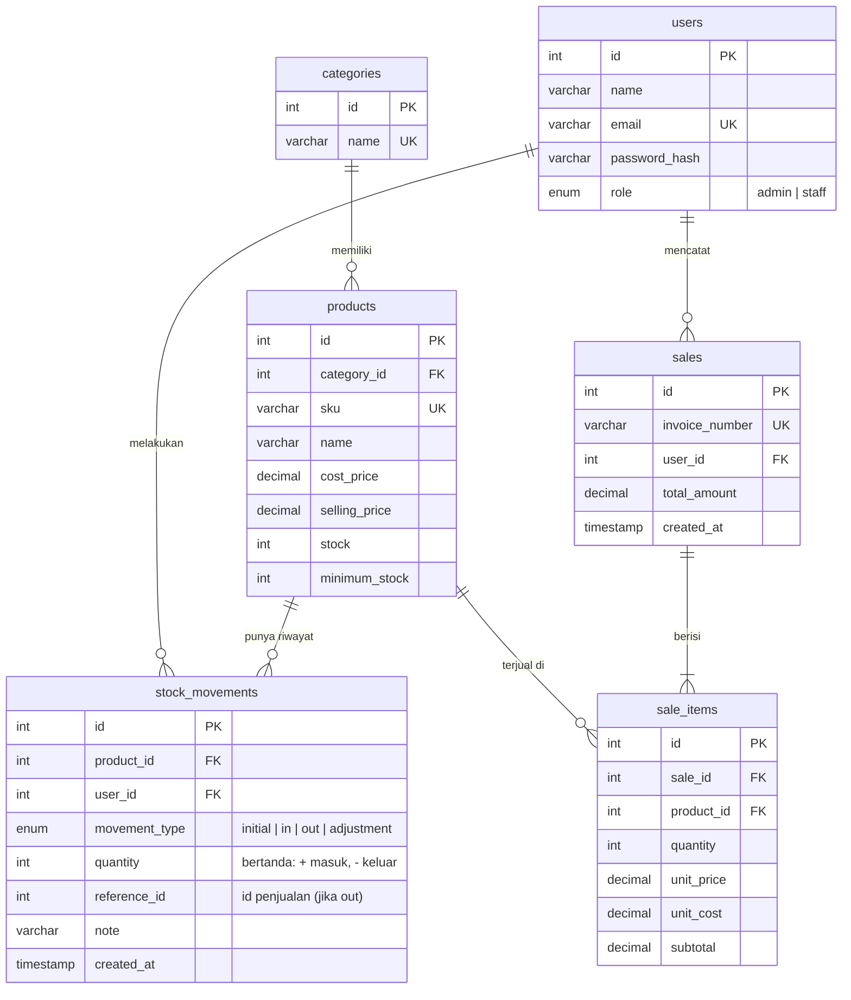

# Entity Relationship Diagram

## Keputusan desain

- `unit_price` dan `unit_cost` di `sale_items` adalah salinan harga saat transaksi, sehingga laporan lama tidak berubah saat harga produk diubah.
- `stock_movements` mencatat alasan setiap perubahan stok, bukan hanya angka akhirnya.
- Produk yang sudah punya riwayat tidak bisa dihapus (dilindungi foreign key).