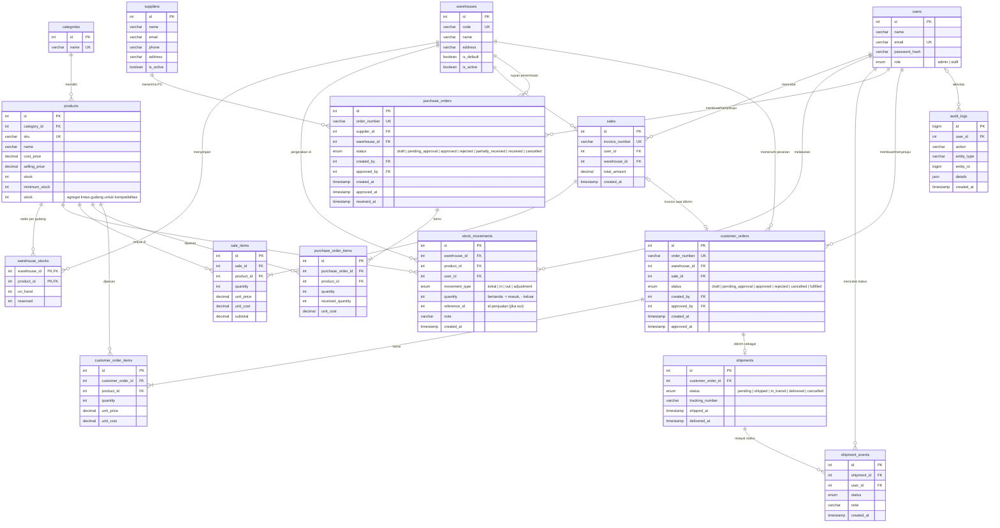

# Entity Relationship Diagram

## Keputusan desain

- `unit_price` dan `unit_cost` di `sale_items` adalah salinan harga saat transaksi, sehingga laporan lama tidak berubah saat harga produk diubah.
- `stock_movements` mencatat alasan setiap perubahan stok, bukan hanya angka akhirnya.
- Produk yang sudah punya riwayat tidak bisa dihapus (dilindungi foreign key).
- `warehouse_stocks` menyimpan saldo fisik dan reservasi per produk/gudang. Stok yang dapat dijual/dipesan adalah `on_hand - reserved`.
- `products.stock` adalah agregat lintas gudang untuk kompatibilitas dengan fitur katalog dan laporan yang sudah ada. Penulisan stok dilakukan bersamaan dengan saldo gudang dalam transaksi.
- Penerimaan PO menambah stok hanya saat barang benar-benar diterima. Pesanan pelanggan menahan stok tersedia; saat shipment menjadi `shipped`, stok fisik dikurangi dan invoice penjualan dibuat.
- Migrasi `database/migrations/001_business_workflows.sql` membuat gudang `MAIN` dan mengalokasikan saldo stok lama ke gudang itu. Jalankan satu kali setelah backup database.